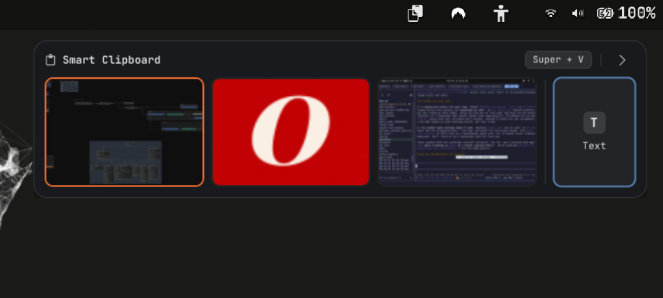

# Smart Clipboard

Fast, one-click clipboard bar for GNOME Shell 51 (Wayland) — click the top-bar icon or press **Super+V** to open a sleek top-right floating overlay with 3 instant preview tiles, a **Text** filter tile, real drag-and-drop into any app, and an expandable **`>`** history drawer.



## Features

- **Instant floating 3-tile bar**: pre-warmed in the background so **Super+V** or clicking the top-bar icon opens immediately with a smooth slide-in right below the panel
- **Rich previews**: full-bleed image previews (raw clipboard images, screenshots, and copied image files), code/text cards with source app header, and live color swatches
- **One-click copy & auto-paste**: click any tile (or press `1`–`3` / `Enter`) to copy, close, and auto-paste into your previous window (`Ctrl+V`, or `Ctrl+Shift+V` in terminals)
- **Hover actions on every tile**: **Copy** (without closing), **Pin** (exempt from pruning; drag pinned items to reorder), **Full Preview** lightbox, and **Delete** with 5-second **Undo** toast
- **Real Wayland drag-and-drop**: drag any tile or history row straight into browsers, Slack, Discord, Files, GIMP, or editors
- **Text filter & expandable drawer**: click **`T` Text** to filter text-only snippets, or click **`>`** (or press `Down`) for search, older history, Private Mode, Clear Unpinned, and Preferences
- **Privacy-first**: skips password managers automatically (`x-kde-passwordManagerHint`, KeePassXC, Bitwarden, GNOME Password) plus one-click Private Mode

## Shortcuts

| Shortcut | Action |
|----------|--------|
| `Super+V` | Open / close clipboard (configurable) |
| Click / `Enter` / `1`–`3` | Copy & auto-paste tile |
| `Left` / `Right` | Move selection across the 3 preview tiles |
| `Down` | Expand full history & search drawer |
| `Space` | Open full-size preview for selected tile |
| `Ctrl+P` | Pin / unpin selected item |
| `Delete` | Delete selected item |
| `Ctrl+Z` | Undo last delete |
| `Escape` | Clear search, collapse drawer, or close |

## Install

```bash
git clone https://github.com/nilaymallikk/smart-clipboard.git
cd smart-clipboard
make install      # compiles schemas and symlinks into ~/.local/share/gnome-shell/extensions
```

Log out and back in on Wayland, then enable:

```bash
gnome-extensions enable smart-clipboard@nilaymallik.local
```

Left-click the top-bar icon to toggle the clipboard; right-click for quick actions (Private Mode, Auto-Paste, Clear Unpinned, Preferences). Remove with `make uninstall`.

## Develop & Test

```bash
make check              # compile schemas + syntax checks + store & client tests
make test-headless      # isolated headless GNOME Shell 51 enable/disable test
make test-image-capture # headless raw PNG capture + GC + auto-paste regression test
```

## Settings

| Key | Default | Meaning |
|-----|---------|---------|
| `smart-clipboard-toggle` | `<Super>v` | Global toggle shortcut |
| `max-text-history` | `50` | Unpinned text entries kept |
| `max-image-history` | `20` | Unpinned image entries kept |
| `max-image-size-mb` | `10` | Largest image stored |
| `capture-images` | `true` | Record copied images |
| `persist-history` | `true` | Save history across sessions |
| `private-mode` | `false` | Pause recording |
| `auto-paste` | `true` | Auto-paste on click / Enter (`Ctrl+Shift+V` in terminals) |

## Layout

| File | Purpose |
|------|---------|
| `extension.js` | Extension lifecycle, shortcut, auto-paste, popup pre-warm & positioning |
| `clipboardWatcher.js` | `Meta.Selection` clipboard capture & password-manager filtering |
| `historyStore.js` | Storage, dedupe, classification, pin order, undo, search scoring |
| `dbusService.js` | Session D-Bus bridge between extension and GTK4 popup |
| `popupUi.js` | Top-bar panel indicator (left-click toggle, right-click quick menu) |
| `popupApp.js` | Frameless GTK4/Libadwaita 3-tile floating bar, drawer, and Wayland DnD |
| `popupClient.js` | D-Bus client, filtering, local image resolution, drag ContentProvider |
| `popup.css` | Floating dark card styling |
| `prefs.js` | GNOME Preferences window |
| `schemas/` | GSettings schema |
| `tests/` | Unit tests |
| `docs/preview.png` | Screenshot preview |
